# Antry — Pembagi Jam Akses biar Server Nggak Tumbang

**Login bareng bikin down. Antry bagi jamnya.**

---

## Masalahnya

Bukan serangan. Bukan bug. Cuma **500 orang yang membuka situs di detik yang sama**.

Situs kampus, layanan pendaftaran, toko online saat flash sale — semuanya tumbang karena
pengunjung datang bersamaan lalu menekan refresh berulang saat server mulai lambat. Retry
beruntun itu justru menyelesaikan pekerjaan yang sudah dimulai beban awal.

Host tidak punya cara bilang *"jangan sekarang, coba jam 10:30"* tanpa menempel pengumuman di
tempat yang tidak dibaca siapa pun.

## Antry

Antry memotong trafik jadi **sesi waktu yang bisa dipesan**. Host membuat antrean, membagikan
satu tautan, pengunjung memilih hari dan jam — tanpa akun, tanpa aplikasi, tanpa antre di depan
layar.

**500 pengunjung → 24 sesi × 50 kursi.** Server tetap hidup, pengunjung tetap dapat akses, host
punya data siapa datang kapan.

### Fitur

- **Antrean sesi** — slot 30 menit (atau mode harian), kuota per sesi, tautan pendek `/a/[kode]`
- **Rekomendasi jam sepi** — sesi dengan okupansi terendah ditandai `Direkomendasi · jam sepi`,
  lengkap dengan tombol **Pakai jam ini**
- **Bar beban per sesi** — hijau / kuning / merah, plus peringatan saat sesi pilihan hampir penuh
- **Wizard 3 langkah** untuk host — nama & tanggal → jam & kuota → simpan & tautan
- **Heatmap hari × jam** — host langsung lihat jam mana yang menumpuk
- **Daftar peserta + check-in** — kode booking, nama otomatis, penanda kesamaan perangkat
- **Pengumuman per situs** — gangguan, jam ramai, pemeliharaan, dengan laporan dari pengunjung
- **Panel admin** — setujui host baru, tinjau laporan, tarik pengumuman palsu
- **Kode akses per perangkat** — satu perangkat satu booking per antrean, tanpa akun peserta
- **Mobile-first** — alur pilih sesi dirancang untuk dibuka dari WhatsApp di layar kecil

---

## Tampilan

**Beranda** — cerita singkat, papan status, dan jam WIB yang hidup.

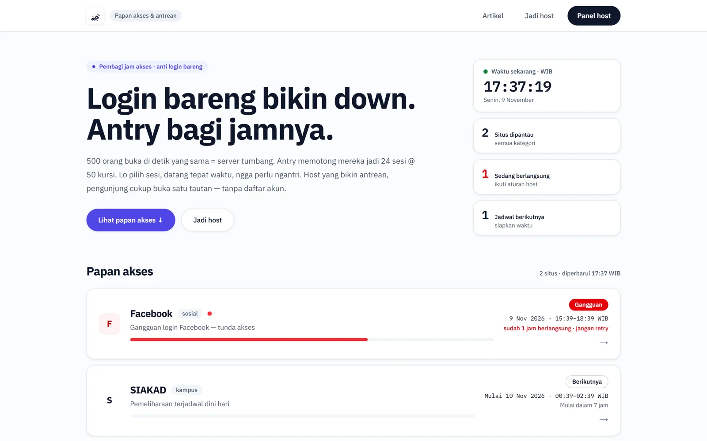

| Jadwal per situs | Wajib dibaca sebelum antri |
| :---: | :---: |
| 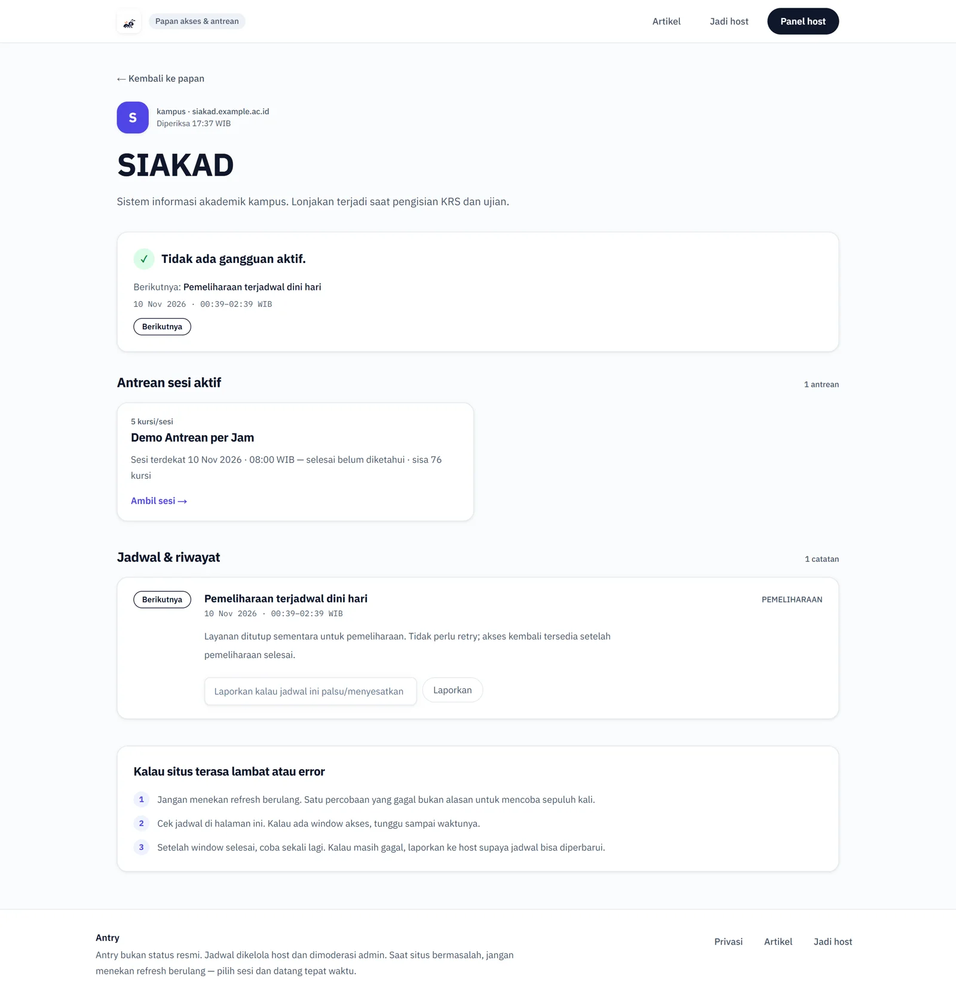 | 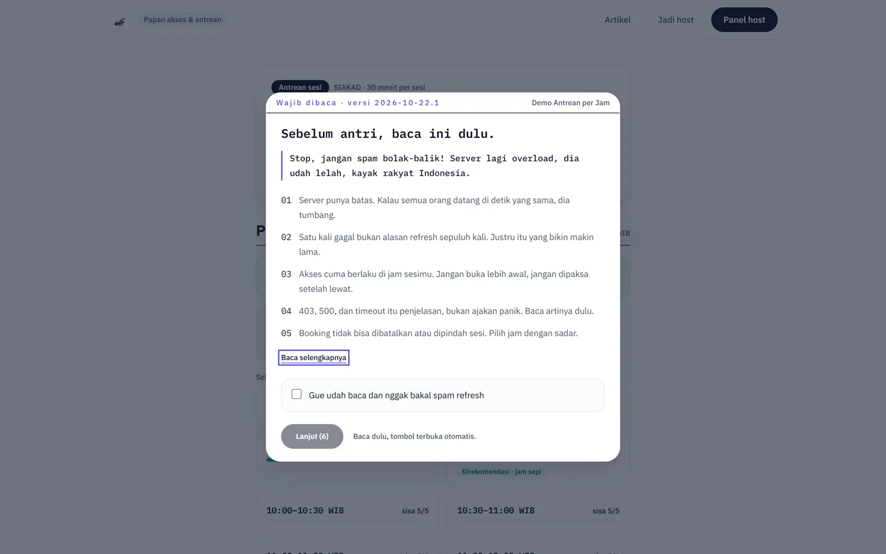 |

**Pilih hari & jam** — rekomendasi jam sepi, bar beban, dan sisa kursi per sesi.

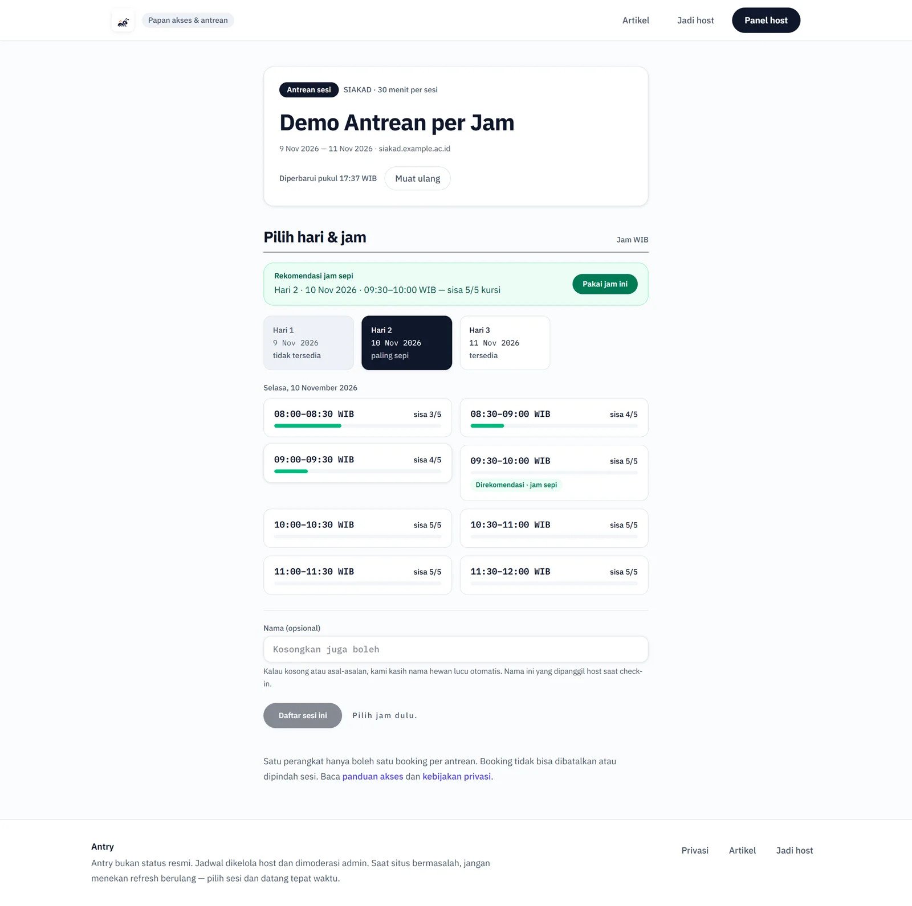

| Sesi dipilih | Panel host |
| :---: | :---: |
| 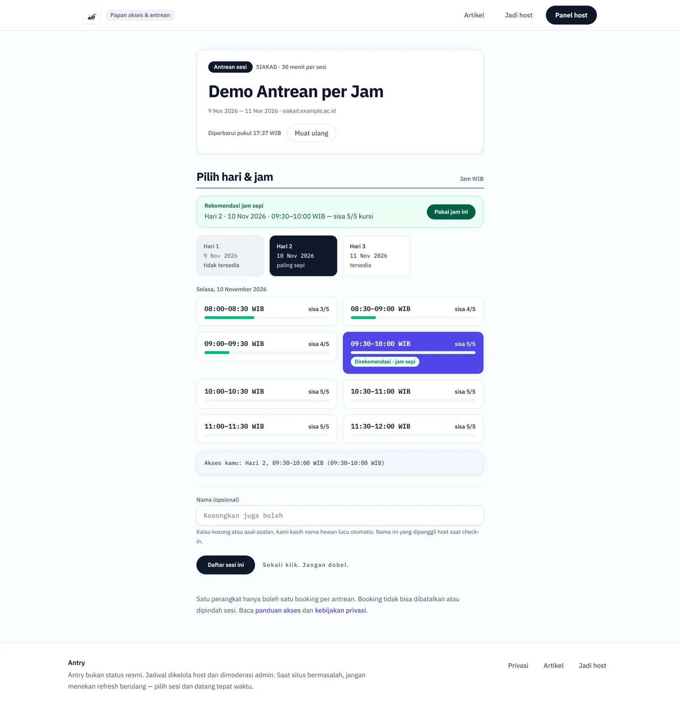 | 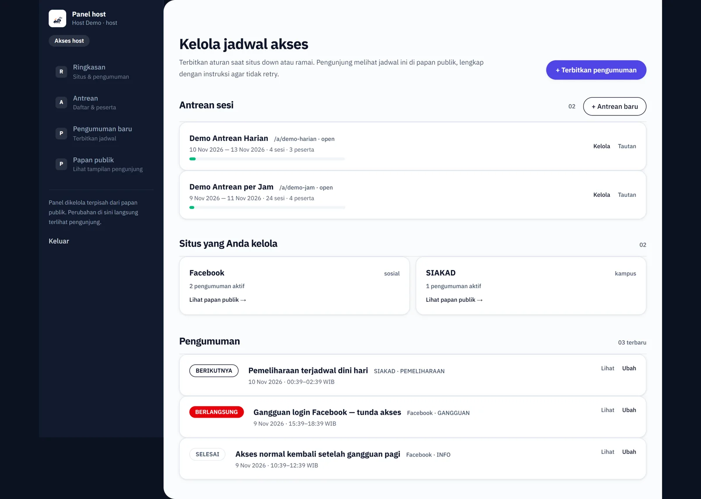 |

**Daftar antrean** — bar beban per antrean, plus peringatan saat kursi hampir habis.

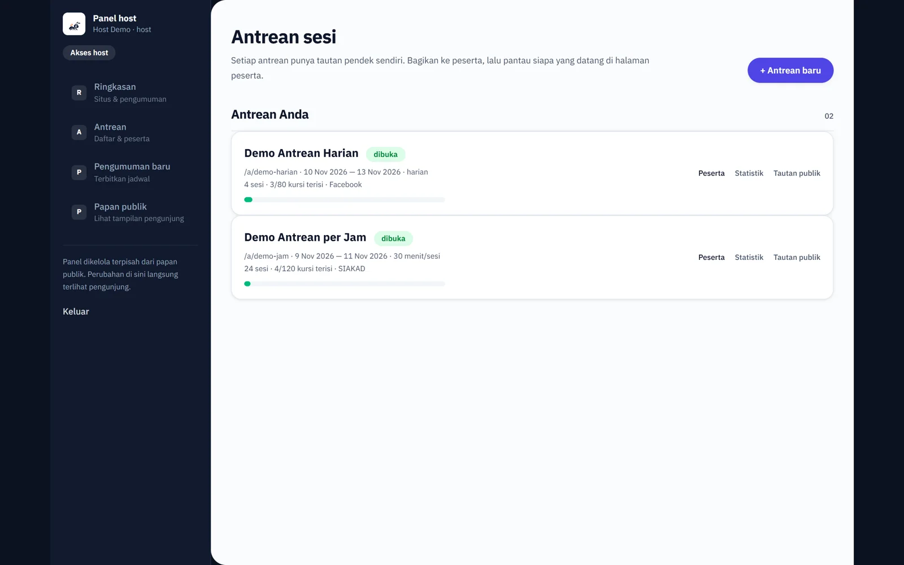

**Kelola antrean** — tautan pendek + QR untuk dibagikan, sisa kuota per sesi, daftar peserta.

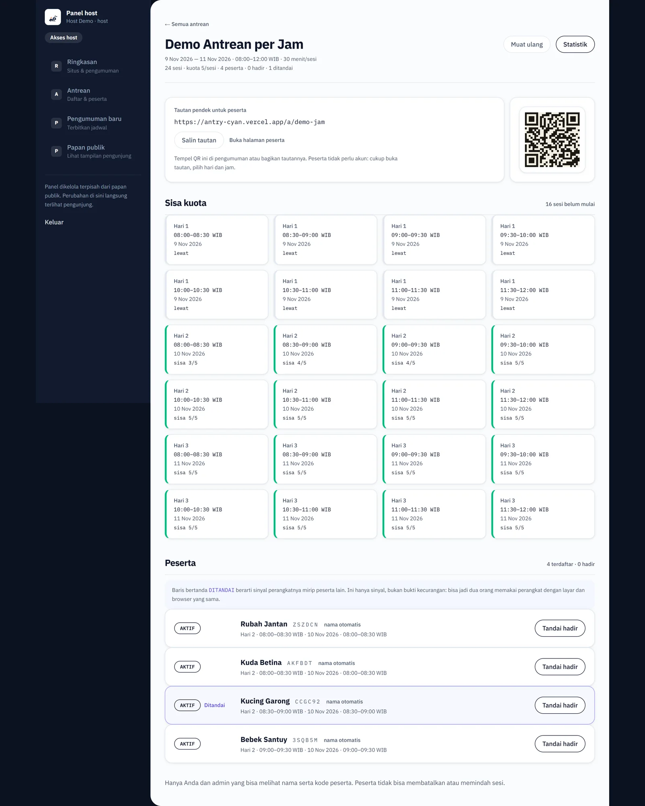

| Statistik & heatmap | Panel admin |
| :---: | :---: |
| 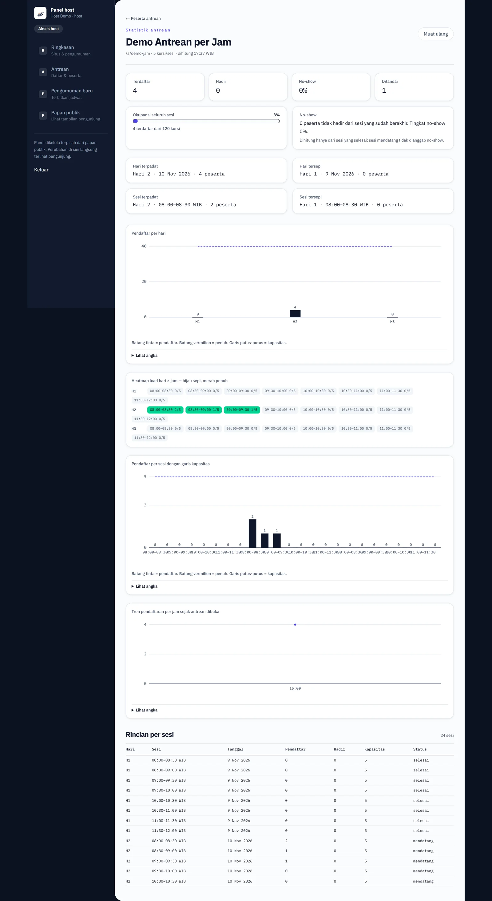 | 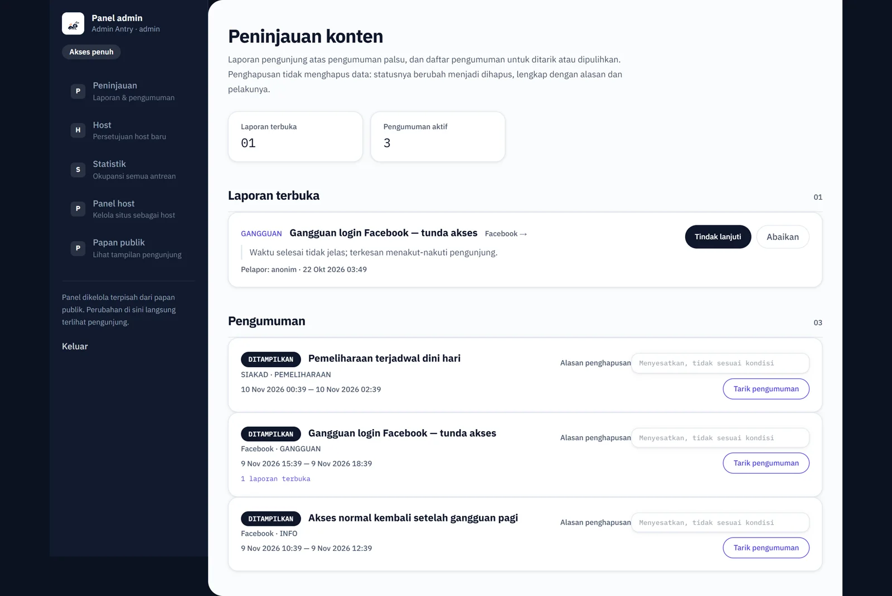 |

**Di HP** — pengunjung datang dari tautan WhatsApp, jadi alurnya diuji di 390px.

| Beranda | Wajib dibaca | Pilih sesi |
| :---: | :---: | :---: |
| 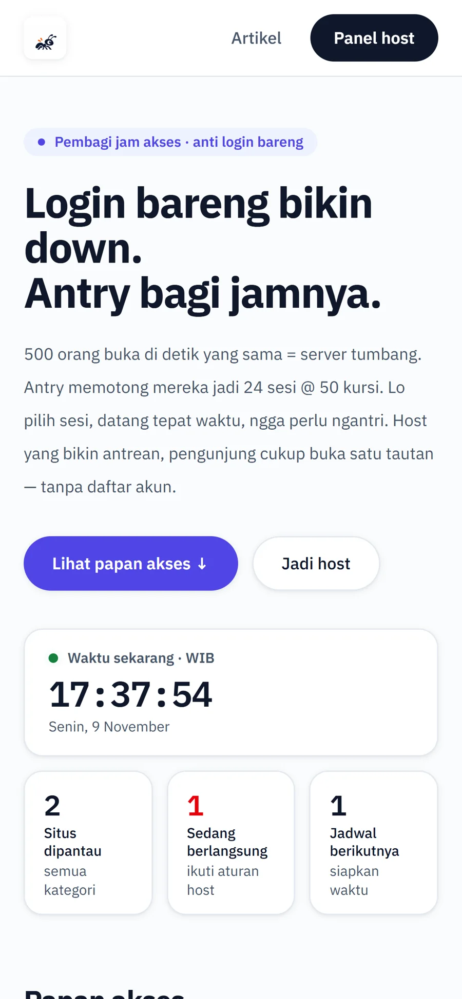 | 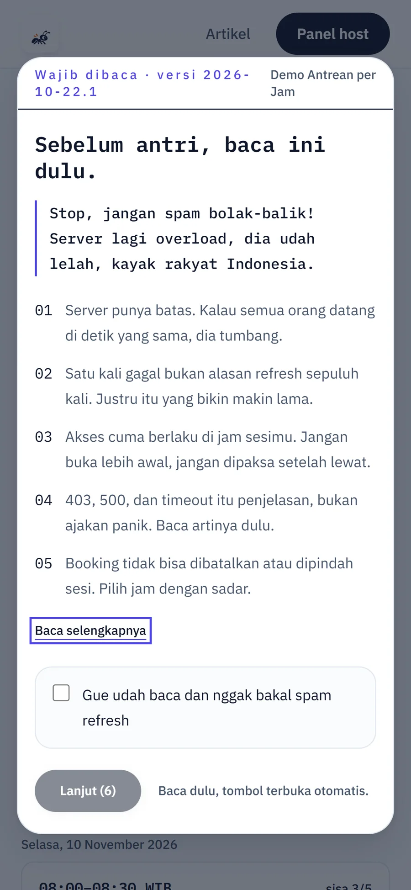 | 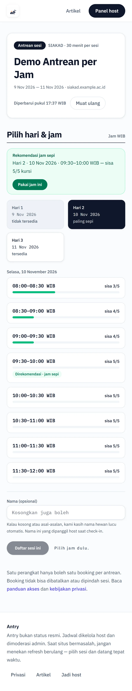 |

---

## Arsitektur

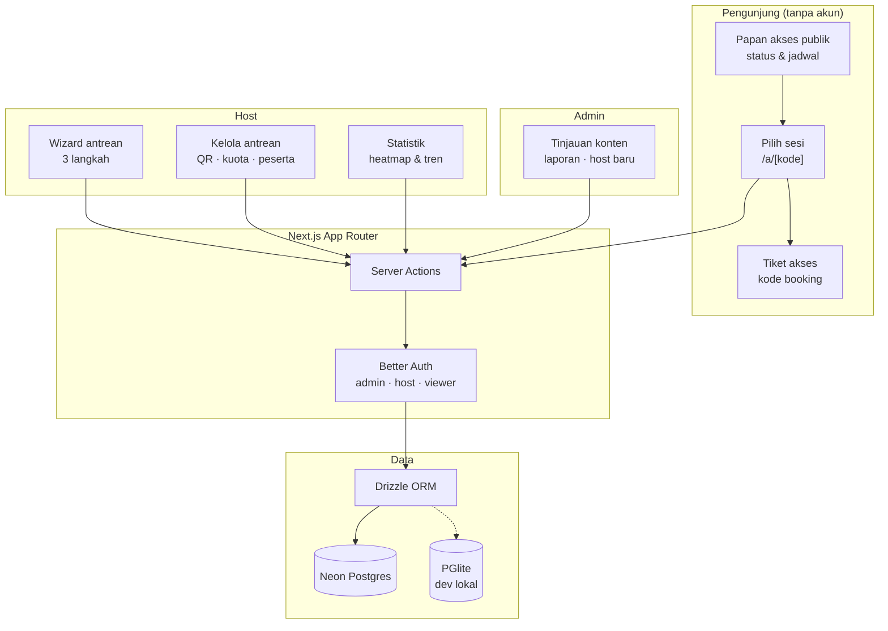

Keputusan desain yang penting:

- **Status waktu dihitung dari timestamp, bukan disimpan.** Buka/tutup sesi, "sedang berlangsung",
  dan "selesai" diturunkan saat dibaca — tidak ada cron yang bisa telat jalan.
- **Satu statement SQL untuk mutasi kritis.** Driver HTTP Neon tidak punya transaksi interaktif, jadi
  booking + cek kuota + cek booking ganda ditulis sebagai satu CTE yang atomik.
- **Rekomendasi jam sepi dihitung di klien.** Data slot sudah dikirim ke halaman, jadi rekomendasi
  berubah instan saat pengunjung berpindah hari tanpa request tambahan.
- **PGlite untuk pengembangan.** Postgres asli yang berjalan sebagai file lokal — `npm run dev`
  tidak butuh akun cloud. Kode yang sama jalan di Neon saat produksi.
- **Peserta tanpa akun, tapi tetap terbendung.** Satu perangkat satu booking per antrean lewat kode
  perangkat; fingerprint ringan hanya dipakai sebagai *sinyal* untuk host, bukan bukti kecurangan.

---

## Stack

| Lapisan | Teknologi |
| :--- | :--- |
| Framework | Next.js 16 (App Router, Turbopack) + React 19 |
| Bahasa | TypeScript |
| Basis data | Neon Postgres (serverless HTTP) |
| ORM | Drizzle (`drizzle-kit` untuk migrasi) |
| Autentikasi | Better Auth — email + password, peran `admin` / `host` / `viewer` |
| Dev lokal | PGlite (Postgres asli, tanpa akun) |
| Styling | Tailwind CSS v4 |
| Konten | MDX, dibangun statis |
| Pembagian waktu | Asia/Jakarta, dihitung eksplisit di server |

---

## Status

Proyek ini **berjalan sebagai produk**, dan source code-nya disimpan privat.

Repository ini adalah **showcase**: dokumentasi produk, arsitektur, tampilan, dan keputusan desain.
Isi `src/` tidak dipublikasikan.

Demo: <https://antry-cyan.vercel.app> — antrean contoh di `/a/demo-jam` dan `/a/demo-harian`.

Untuk pertanyaan, demo, atau diskusi teknis: buka issue di repository ini.

---

## English

**Antry** is a session-based access queue for any website. Hosts create a queue, share one short link, and visitors book a time slot instead of arriving at the same second and hammering refresh. No visitor account is needed — a per-device code is enough.

The point is to cut the retry storm: 500 visitors become 24 sessions of 50 seats, and the host gets data on who arrives when. Hosts and admins sign in; the public board, booking flow, and error articles stay open.

The source code is not published; this repository documents the product.

---

**Dibuat oleh [Kandar Lubis](https://github.com/kandarlubis31)**

---

## Lisensi

**All Rights Reserved.** Copyright © 2026 Kandar Lubis.

Kode sumber tidak dipublikasikan dan tidak dilisensikan untuk digunakan ulang. Dokumentasi ini
disajikan untuk peninjauan dan evaluasi.
